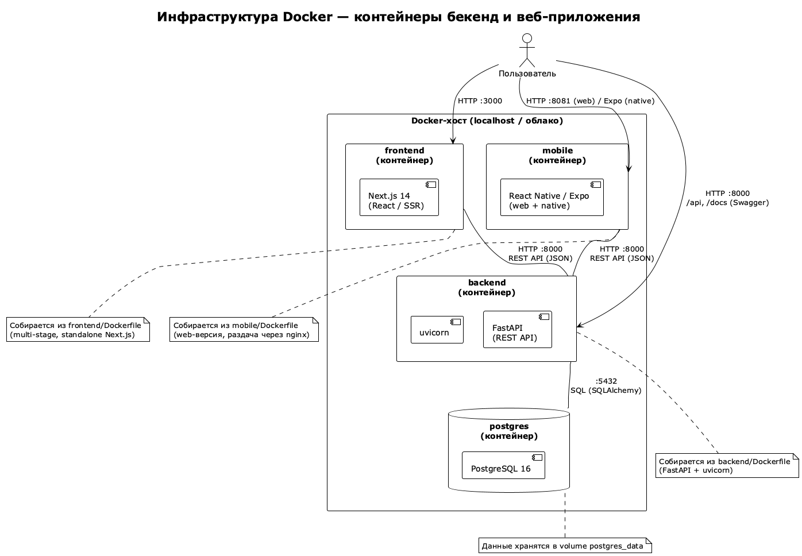

# Задание 6. Инфраструктура проекта и её развёртывание

Веб-приложение **«Умный Календарь»** (AI_Calendar_App).
Данный раздел лабораторной работы `lab4/task6` содержит результат выполнения
задания 6: проектирование и развёртывание инфраструктуры бекенда и
веб-приложения на основе Docker, настройку CI/CD, SonarQube и документации.

> **Проект:** AI_Calendar_App · **Дисциплина:** Курсовая работа по разработке веб-приложений
> **Автор:** Шибитов Николай, группа 11, курс 3

---

## Содержание

- [1. Структура репозитория](#1-структура-репозитория)
- [2. Ветки и правила работы с ними](#2-ветки-и-правила-работы-с-ними)
- [3. Управление проектом (GitHub Projects)](#3-управление-проектом-github-projects)
- [4. План работ по бекенду](#4-план-работ-по-бекенду)
- [5. Документирование проекта](#5-документирование-проекта)
- [6. Автоматические тесты](#6-автоматические-тесты)
- [7. Инфраструктура Docker (PlantUML)](#7-инфраструктура-docker-plantuml)
- [8. Контейнеризация и Docker Compose](#8-контейнеризация-и-docker-compose)
- [9. Приложение «Hello World»](#9-приложение-hello-world)
- [10. Непрерывная интеграция (GitHub Actions)](#10-непрерывная-интеграция-github-actions)
- [11. Swagger в CI/CD](#11-swagger-в-cicd)
- [12. SonarQube](#12-sonarqube)
- [13. Развёртывание на облачной платформе](#13-развёртывание-на-облачной-платформе)
- [14. Отчёт](#14-отчёт)
- [15. Мобильное приложение](#15-мобильное-приложение)

---

## 1. Структура репозитория

```
lab4/task6/
├── README.md                        # настоящий документ
├── docker-compose.yml               # окружение разработки «Hello World»
├── backend/                         # бекенд «Hello World» (FastAPI)
│   ├── app.py                       # приложение (GET /, /health, /docs)
│   ├── test_app.py                  # автоматические тесты (pytest)
│   ├── requirements.txt
│   └── Dockerfile
├── frontend/                        # веб-приложение «Hello World» (Next.js)
│   ├── src/app/
│   │   ├── layout.tsx
│   │   └── page.tsx
│   ├── package.json
│   ├── tsconfig.json
│   ├── next.config.mjs              # output: 'standalone'
│   ├── Dockerfile                   # multi-stage сборка
│   └── .dockerignore
├── mobile/                          # мобильное приложение «Hello World» (React Native/Expo)
│   ├── App.tsx                      # экран «Hello World from Mobile!»
│   ├── index.js
│   ├── app.json
│   ├── package.json
│   ├── Dockerfile                   # сборка web-версии + nginx
│   └── .dockerignore
├── diagrams/                        # PlantUML-диаграммы инфраструктуры (п. 7)
│   ├── infrastructure_context.puml/.png
│   ├── infrastructure_container.puml/.png
│   └── deployment.puml/.png
├── sonar/                           # конфигурация SonarQube (п. 12)
│   ├── sonar.compose.yml            # локальный SonarQube в Docker
│   └── sonar-project.properties     # параметры анализа
├── .github/workflows/ci.yml         # GitHub Actions CI/CD (п. 6, 10–13)
└── docs/                            # документация (п. 5, 14)
    ├── wiki/                        # содержимое GitHub Wiki
    ├── github-pages/                # содержимое GitHub Pages
    └── report.md                    # отчёт по заданию
```

---

## 2. Ветки и правила работы с ними

В репозитории созданы две основные ветки (п. 2):

| Ветка | Назначение | Окружение |
|-------|-----------|-----------|
| `main` | **production** (релизная версия) | стабильная, деплой в облако |
| `develop` | **development** (тестовая версия) | ежедневная разработка |

**Правила работы с ветками:**
1. Вся разработка ведётся только через систему контроля версий (git).
2. Новые задачи выполняются в отдельных ветках `feature/<имя>` от `develop`.
3. По завершении задачи ветка вливается в `develop` через **Pull Request**
   (обязательное ревью и прогон CI).
4. Из `develop` в `main` изменения попадают только через релизный Pull Request
   после прохождения всех тестов и проверки качества кода.
5. Прямые пуши в `main` и `develop` запрещены (защита веток в GitHub).
6. Сообщения коммитов — по схеме Conventional Commits
   (`feat:`, `fix:`, `docs:`, `test:`, `ci:`).

---

## 3. Управление проектом (GitHub Projects)

Управление задачами ведётся в **GitHub Projects** (п. 3). В основном
репозитории созданы проекты:

- **Дизайн и проектирование приложений** — общая документация, ТЗ, отчёты по
  лабораторным работам.
- **Разработка API и бизнес-логики** — задачи по бекенду (REST API, БД,
  авторизация, AI-аналитика).
- **Разработка веб-приложения** — задачи по фронтенду (Next.js, UI, API-клиент).
- **Разработка мобильного приложения** — задачи по мобильной версии.

Каждая задача имеет статус: `Todo → In Progress → In Review → Done`.
Коммуникация команды — в мессенджере (Slack / Telegram).

---

## 4. План работ по бекенду

План составлен на основе технического задания (п. 1 лабораторной работы) и
оформлен как задачи GitHub Projects. Подробный план — в
[`docs/backend_plan.md`](docs/backend_plan.md).

| № | Задача | Статус |
|---|--------|--------|
| 1 | Каркас FastAPI-приложения, конфигурация, health-check | Done |
| 2 | Модели БД (User, Event, Note, Template, Notification) + Alembic | Done |
| 3 | JWT-авторизация (register/login/refresh/me) | Done |
| 4 | CRUD событий, заметок, шаблонов | Done |
| 5 | Аналитика и уведомления | Done |
| 6 | AI-анализ продуктивности (Ollama/DeepSeek) | Done |
| 7 | Автоматические тесты (pytest) | In Progress |
| 8 | Docker-инфраструктура и docker-compose | Done |
| 9 | Swagger/OpenAPI-документация | Done |
| 10 | SonarQube-анализ качества кода | Done |
| 11 | CI/CD: сборка, тесты, деплой | Done |

---

## 5. Документирование проекта

Документация проекта ведётся в трёх местах (п. 5):

- **README** — настоящий файл (`README.md`).
- **GitHub Wiki** — расширенная документация, см. [`docs/wiki/`](docs/wiki/).
- **GitHub Pages** — публичный статический сайт документации, см.
  [`docs/github-pages/`](docs/github-pages/).

Требования к документированию соответствуют разделу **«Документирование
проекта»**: описаны архитектура, API, порядок развёртывания, инструкции для
разработчика и пользователя.

---

## 6. Автоматические тесты

Перед сборкой сервер CI выполняет автоматические тесты и формирует сборку
только после их прохождения (п. 6). Тесты бекенда запускаются через `pytest`:

```bash
cd lab4/task6/backend
pip install -r requirements.txt
pytest -v
```

В `ci.yml` этап `test-backend` и `test-frontend` выполняются до сборки
образов (`build`), которая запускается только при успешных тестах.

---

## 7. Инфраструктура Docker (PlantUML)

Инфраструктура бекенда и веб-приложения спроектирована в PlantUML (п. 7).
Диаграммы уточняют схемы лабораторной работы 3 под контейнерную архитектуру:

- [`infrastructure_context.puml`](diagrams/infrastructure_context.puml) —
  системный контекст (пользователь, GitHub, CI/CD, облако).
- [`infrastructure_container.puml`](diagrams/infrastructure_container.puml) —
  контейнеры Docker (frontend, backend, PostgreSQL).
- [`deployment.puml`](diagrams/deployment.puml) — развёртывание и CI/CD pipeline.



---

## 8. Контейнеризация и Docker Compose

Инфраструктура развёрнута на основе контейнеров, конфигурация описана в
`Dockerfile` и запускается через **Docker Compose** (п. 8):

```bash
cd lab4/task6
docker compose up --build
```

| Сервис | Порт | Описание |
|--------|------|----------|
| `backend` | `8000` | FastAPI «Hello World» (Swagger: `/docs`) |
| `frontend` | `3000` | Next.js «Hello World» |
| `mobile` | `8081` | React Native/Expo «Hello World» (web) |

Остановка: `docker compose down`.

---

## 9. Приложение «Hello World»

Для иллюстрации работоспособности каждого окружения добавлено простое
приложение «Hello World» (п. 9):

- **Backend** (`backend/app.py`): `GET /` → `Hello World from Backend!`;
  `GET /health` → `{"status": "ok"}`; `GET /docs` → Swagger UI.
- **Frontend** (`frontend/src/app/page.tsx`): страница
  `Hello World from Frontend!`.
- **Mobile** (`mobile/App.tsx`): экран `Hello World from Mobile!`
  (React Native/Expo; web-версия доступна через контейнер).

Проверка:
- Backend: `curl http://localhost:8000/`
- Frontend: открыть `http://localhost:3000`
- Mobile: открыть `http://localhost:8081` (web-версия)

---

## 10. Непрерывная интеграция (GitHub Actions)

Для автоматизации сборки настроен сервис CI — **GitHub Actions** (п. 10),
`.github/workflows/ci.yml`. Обеспечивается сборка с docker-контейнерами
(этап `build` использует `docker/build-push-action`).

Pipeline:

```
push (develop/main)
      │
      ▼
test-backend (pytest) ─┐
test-frontend (build)  ├─► sonarqube (качество) ──► build (Docker + Swagger) ──► deploy (Render)
test-mobile (build)    ┘
```

---

## 11. Swagger в CI/CD

В процесс CI/CD встроена генерация файлов Swagger одним из этапов сборки
(п. 11). На этапе `build` из работающего FastAPI-приложения извлекается
OpenAPI-схема:

```bash
python -c "from app import app; open('swagger.json','w').write(app.openapi().to_json())"
```

Сгенерированный `swagger.json` доступен в артефактах сборки; интерактивный
Swagger UI доступен на `/docs` в работающем приложении.

---

## 12. SonarQube

Настроен сервис проверки качества кода **SonarQube** (п. 12):

- **Локальная версия** — запуск через Docker
  (`sonar/sonar.compose.yml`, `http://localhost:9000`) для бекенда и
  веб-приложения:
  ```bash
  docker compose -f sonar/sonar.compose.yml up -d
  cd backend && sonar-scanner -Dsonar.login=<TOKEN>
  ```
- **Облачная версия** — подключена как этап CI/CD в `ci.yml` (job
  `sonarqube`) через `sonarsource/sonarqube-scan-action`.

Изучены статьи:
- https://www.codeflow.site/ru/article/sonar-qube
- https://habr.com/ru/companies/sportmaster_lab/articles/746320/

---

## 13. Развёртывание на облачной платформе

Бекенд развёрнут из контейнеров Docker после прохождения тестов и проверки
качества кода на бесплатной платформе **Render.com** (п. 13). Этап `deploy`
в `ci.yml` выполняется при пуше в `main` и использует `render-action`.

- Backend: развёрнут как Web Service на Render (Docker-контейнер) + PostgreSQL.
- Frontend: развёрнут локально / на другой учётной записи (бесплатный тариф).

Необходимые секреты в GitHub:
`SONAR_TOKEN`, `SONAR_HOST_URL`, `RENDER_API_KEY`, `RENDER_SERVICE_ID`.

---

## 14. Отчёт

Отчёт по всем пунктам задания и вклад участников — в
[`docs/report.md`](docs/report.md).

---

## 15. Мобильное приложение

Согласно заданию (п. 2–4, 14) проект включает **мобильную версию**. В этом
разделе подготовлена заготовка мобильного приложения «Hello World» на
**React Native + Expo** (`mobile/`):

- `App.tsx` — экран `Hello World from Mobile!`.
- `app.json` — конфигурация Expo (идентификаторы iOS/Android).
- `Dockerfile` — сборка web-версии и раздача через nginx.
- CI-джобы `test-mobile` (сборка web-экспорта) и сборка образа `mobile`.

Запуск web-версии в контейнере:
```bash
cd lab4/task6
docker compose up --build mobile   # http://localhost:8081
```

Для нативных платформ (iOS/Android) используется Expo Go / EAS Build —
`npm start`, `npm run android`, `npm run ios`.